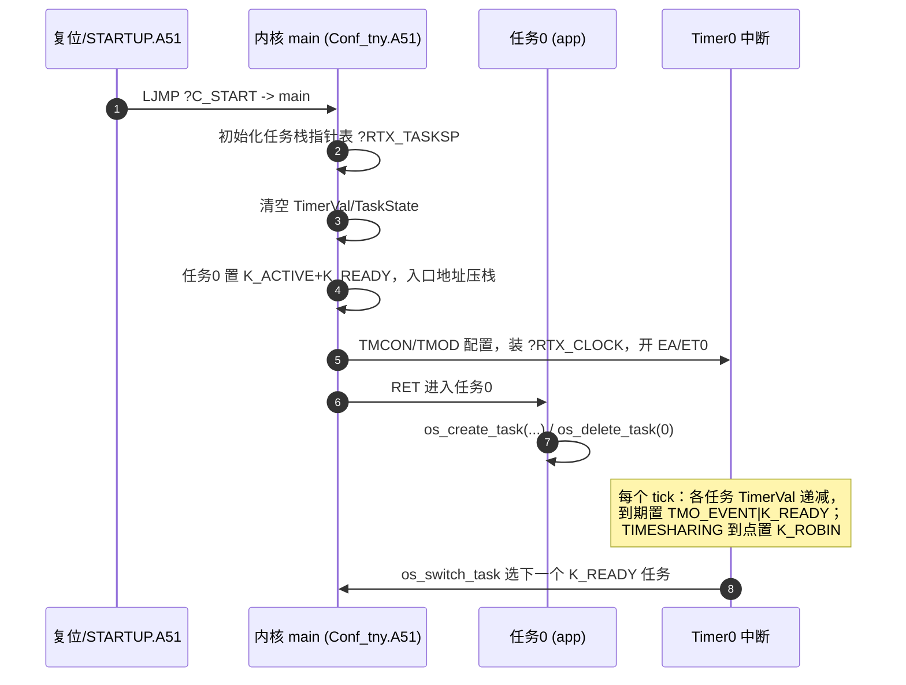
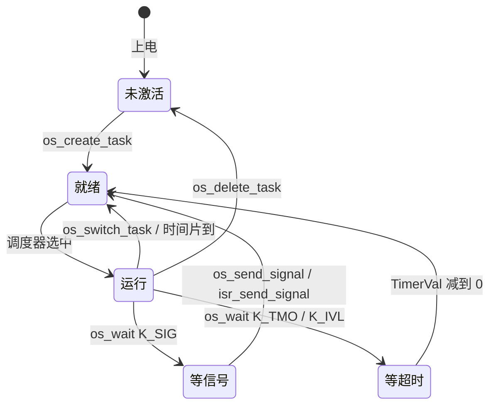

# RTX51 Tiny 使用手册（面向 SC95F7617B / Keil C51）

> 适用对象：已经会 8051 汇编/C51、要在本仓库 `soc/RTX51_Tiny_Demo/` 这类工程里使用
> **RTX51 Tiny v2.02** 的开发者。
>
> 事实来源：本仓库 `src/templete/` 的内核与系统调用源码（`Conf_tny.A51`、`os_*.a51`、
> `RTX51TNY.H`）、`soc/RTX51_Tiny_Demo/` 的实际移植工程、Keil 官方 RTX51 Tiny v2 ReadMe，
> 以及 `SC95F7617B...v0.1en.pdf` 数据手册（引用处标注页码/文件:行）。

---

## 目录

1. [RTX51 Tiny 是什么](#1-rtx51-tiny-是什么)
2. [内核原理速览](#2-内核原理速览)
3. [在 Soc 工程里启用（工程配置清单）](#3-在-soc-工程里启用工程配置清单)
4. [任务编写规则](#4-任务编写规则)
5. [os_* API 逐个详解](#5-os_-api-逐个详解)
6. [Conf_tny.A51 配置项与节拍计算](#6-conf_tnya51-配置项与节拍计算)
7. [SC95F7617B 专属适配要点](#7-sc95f7617b-专属适配要点)
8. [与裸机中断协作](#8-与裸机中断协作)
9. [常见陷阱与调试](#9-常见陷阱与调试)
10. [最小可编译模板](#10-最小可编译模板)
11. [参考](#11-参考)

---

## 1. RTX51 Tiny 是什么

RTX51 Tiny 是运行在 8051 内核上的**非抢占、按时间片轮询**的实时内核，以"库 + 配置汇编文件"
形式提供。它用 **Timer0** 产生系统节拍，用每个任务独立的**栈**实现上下文切换。

### 1.1 关键特性（v2.02）

| 项目 | 数值/说明 |
|------|-----------|
| 最大任务数 | 16（任务号 0~15） |
| 最大活动任务 | 16 |
| 代码空间 | ≤ 约 900 字节（与配置有关，可裁剪） |
| 数据空间 | ≥ 约 7 字节（任务表等，见 §7.3） |
| 每个任务栈开销 | ≥ 3 字节 |
| 系统节拍因子 INT_CLOCK | 1 ~ 65535（16 位定时器上限） |
| 中断等待 | ≤ 20 个机器周期 |
| 上下文切换 | 100 ~ 700 个机器周期 |
| 调度方式 | 时间片轮询（可关）＋ 事件驱动（`os_wait`） |
| 抢占能力 | 无优先级；仅时间片到点或任务主动阻塞时切换 |

### 1.2 组成文件

| 文件 | 角色 | 由谁提供 |
|------|------|----------|
| `RTX51TNY.LIB` | 系统调用（`os_create_task`/`os_wait`/…） | Keil `C51\LIB`（本仓库 `src/templete/RTX51TNY.LIB` 同为 v2.02） |
| `Conf_tny.A51` | **内核本体 + 配置**：`main`、Timer0 中断、任务切换、任务表 | 你的工程提供（复制自 `src/templete/Conf_tny.A51` 再改） |
| `RTX51TNY.H` | 应用包含的 API 声明与事件常量 | Keil `C51\INC` |
| `STARTUP.A51` | 标准 8051 启动代码 | 工程提供（保持默认即可） |
| `os_*.a51` | 系统调用的**源码**（仅当你想自己重建 `.LIB` 时才需要） | 仓库 `src/templete/` |

> 关键理解：**内核（`main`/调度/定时中断）在 `Conf_tny.A51` 里**，`.LIB` 只提供 `os_*` 系统调用。
> 因此模板工程**必须**把自己的 `Conf_tny.A51` 加进工程；库里的内核模块因符号已被你的
> `Conf_tny.obj` 定义而不会被链接出来。

---

## 2. 内核原理速览

### 2.1 启动时序



### 2.2 任务状态位（`Conf_tny.A51:255-286`）

| bit | 掩码 | 名称 | 含义 |
|-----|------|------|------|
| 0 | `K_SIG`=0x01 | 等待信号 | 正在等 `os_send_signal` |
| 1 | `K_TMO`=0x02 | 等待超时 | 正在等超时/间隔 |
| 2 | `SIG_EVENT`=0x04 | 信号事件到 | 已被发送信号 |
| 3 | `TMO_EVENT`=0x08 | 超时事件到 | 计时到点 |
| 4 | `K_READY`=0x10 | 就绪 | 可被调度 |
| 5 | `K_ACTIVE`=0x20 | 激活 | 已 `os_create_task` |
| 6 | `K_ROBIN`=0x40 | 时间片到点 | 需轮转 |
| 7 | `K_IVL`/`RDY_EVENT`=0x80 | 间隔/就绪返回 | `os_wait` 返回值用 |



### 2.3 调度与上下文切换

- 8051 无 MMU，RTX51 Tiny 靠**把每个任务的私有栈帧在公共 IDATA 栈区之间搬运**实现上下文
  切换（`Conf_tny.A51` 中 `os_switch_task` 的"栈隧道搬迁"）。这就是"3 字节/任务栈开销"的由来。
- 切换发生的时机只有三种：
  1. 任务调用 `os_wait` 阻塞；
  2. 任务调用 `os_switch_task` 主动让出；
  3. **时间片到点**（`TIMESHARING != 0`）——注意这是**在任意指令边界**由中断触发的轮转。

---

## 3. 在 Soc 工程里启用（工程配置清单）

以本仓库 `soc/RTX51_Tiny_Demo/RTX51_Tiny.uvproj` 为准，逐项核对：

| # | 设置 | 值 | 位置 |
|---|------|-----|------|
| 1 | Operating System | **RTX-51 Tiny** | Target Options → Target（uvproj `<RTOS>1</RTOS>`） |
| 2 | 加入 `Conf_tny.A51` | 是（FileType=2 汇编） | 工程文件组 |
| 3 | `STARTUP.A51` | 保留默认 | 工程文件组 |
| 4 | 排除冲突文件 | **不要**包含定义了 `main` 或 Timer0 中断（`interrupt 1`）的源文件 | — |
| 5 | Include 路径 | 至少包含 `rtx51tny.h`（Keil 默认 `C51\INC`）与自己头文件目录 | C51 选项卡 |
| 6 | 内存模型 | SMALL（`<MemoryModel>0</MemoryModel>`）或 LARGE；**不要**在数据紧张时用 COMPACT | Target 选项卡 |
| 7 | 链接器 | 沿用 SoC 工具链：LX51 + `REMOVEUNUSED` | Lx51 选项卡 |
| 8 | 中断向量 | 内核占用 Timer0（`interrupt 1`, 向量 `0x0B`）；用户代码不得再定义它 | — |

> 只要把目标选为 RTX-51 Tiny，uVision 会**自动链接** `C51\LIB\RTX51TNY.LIB`，无需手动添加库文件。
> 编译日志应出现：`Program Size: data=… xdata=… const=… code=…` 且 `0 Error(s), 0 Warning(s)`。

编译结果的符号归属自检（可在 `.map` 里确认）：

```
?RTX51_TINY_KERNAL   <- 来自你的 Conf_tny.obj   （内核/配置生效）
?RTX51_TINY_OS_*     <- 来自 C51\LIB\RTX51TNY.LIB（系统调用）
?RTX_MAXTASKN        <- 由 C51 依 _task_ 编号自动生成
```

---

## 4. 任务编写规则

1. **用 C51 的 `_task_ n` 关键字**声明任务函数：`void foo(void) _task_ 2 { ... }`。
   任务号 `n` 决定运行时身份；必须存在 `_task_ 0`（内核第一个运行它）。
2. **任务函数永不返回**：要么 `while(1){...}`，要么自己 `os_delete_task(0)` 后结束。
   返回会导致跑飞（其返回地址不是有效的任务续点）。
3. **`?RTX_MAXTASKN` 由最高的 `_task_` 编号决定**，任务号允许不连续但会浪费任务表字节；
   建议从 0 连续编号。最大 15。
4. **不要自己写 `main()`**：`Conf_tny.A51` 已提供 `main`，C51 启动代码会跳到它。
5. **合作式并发**：默认不抢占（除 `TIMESHARING` 时间片）。长计算要主动 `os_wait`/`os_switch_task`。
6. **重入性**：被多个任务调用的函数必须可重入，否则链接器报 `L15`（详见 §9.2）。
7. **任务栈**：每个任务独立栈（在 IDATA），局部变量多、递归都要考虑栈与 `RAMTOP`。

---

## 5. os_* API 逐个详解

事件/错误常量（`RTX51TNY.H`）：

| 常量 | 值 | 用途 |
|------|-----|------|
| `K_SIG` | 0x01 | `os_wait` 等待信号 |
| `K_TMO` | 0x02 | `os_wait` 等待超时（一次性） |
| `K_IVL` | 0x80 | `os_wait` 等待间隔（周期性） |
| `SIG_EVENT` | 0x04 | 收到信号（返回值） |
| `TMO_EVENT` | 0x08 | 超时/间隔到（返回值） |
| `RDY_EVENT` | 0x80 | READY 标志被置（返回值） |
| `NOT_OK` | 0xFF | 参数错误（部分函数返回值） |

### 5.1 一览表

| 函数 | 原型 | 返回 | 可调用上下文 |
|------|------|------|--------------|
| `os_create_task` | `uchar os_create_task(uchar taskid)` | 0 成功 / 0xFF 失败 | 任务 |
| `os_delete_task` | `uchar os_delete_task(uchar taskid)` | 0 成功 / 0xFF 失败 | 任务 |
| `os_wait` | `uchar os_wait(uchar typ, uchar ticks, uint dummy)` | 事件掩码 | 任务 |
| `os_wait1` / `os_wait2` | `uchar os_wait1(uchar typ)` / `(uchar typ, uchar ticks)` | 事件掩码 | 任务 |
| `os_send_signal` | `uchar os_send_signal(uchar taskid)` | 0/1/0xFF | 任务 |
| `isr_send_signal` | `uchar isr_send_signal(uchar taskid)` | 0/1/0xFF | **中断** |
| `os_clear_signal` | `uchar os_clear_signal(uchar taskid)` | 0/1/0xFF | 任务 |
| `os_set_ready` | `void os_set_ready(uchar taskid)` | — | 任务 |
| `isr_set_ready` | `void isr_set_ready(uchar taskid)` | — | **中断** |
| `os_running_task_id` | `uchar os_running_task_id(void)` | 当前任务号 | 任务 |
| `os_reset_interval` | `void os_reset_interval(uchar ticks)` | — | 任务 |
| `os_switch_task` | `uchar os_switch_task(void)` | 事件掩码 | 任务 |

### 5.2 `os_create_task` / `os_delete_task`

```c
uchar os_create_task(uchar taskid);   // 激活任务
uchar os_delete_task(uchar taskid);   // 使任务失活
```

- `os_create_task`：置 `K_ACTIVE+K_READY`，并把任务入口地址写入其栈，等待调度。
  - **返回 0**：成功；**0xFF**：`taskid > ?RTX_MAXTASKN` 或任务**已激活**。
- `os_delete_task`：清 `K_ACTIVE|K_READY|K_SIG|K_TMO|K_ROBIN`，并从栈隧道移除。
  - **返回 0**：成功；**0xFF**：越界或任务未激活。
  - 若删除的是**当前任务**，会切走且不再返回（配合 `_task_ 0` 初始化后自删）。
- 动态开关任务的典型用法（本仓库 DMX 应用）：运行期 `os_create_task(4)` / `os_delete_task(4)`。

```c
void task_init(void) _task_ 0 {
    os_create_task(1);
    os_create_task(2);
    os_delete_task(0);        /* 任务0 用完即删，不再占任务表 */
}
```

### 5.3 `os_wait` —— 阻塞/等待（核心）

```c
uchar os_wait(uchar typ, uchar ticks, uint dummy);  // dummy 恒传 0
uchar os_wait1(uchar typ);                          // 只等待信号，等价 os_wait(typ,0,0)
uchar os_wait2(uchar typ, uchar ticks);             // 少一个 dummy
```

参数：`typ` = 事件的按位或；`ticks` = 超时/间隔节拍数（**0~255**）。

| `typ` | 行为 | 常见返回 |
|-------|------|----------|
| `K_SIG` | 阻塞直到收到信号 | `SIG_EVENT` |
| `K_TMO` | 等待 `ticks` 个节拍（**每次调用重新装载计时器**，长期看会漂移） | `TMO_EVENT` |
| `K_IVL` | **间隔等待**（计时器累加，周期性更好，适合周期任务） | `TMO_EVENT` |
| `K_SIG` 与 `K_TMO` 组合等 | 任一事件到即返回 | 对应位组合 |
| `ticks==0` 且带 `K_TMO`/`K_IVL` | **立即返回** `TMO_EVENT`（非阻塞轮询） | `TMO_EVENT` |

要点：
- **只能在任务里调用**，绝不能在中断里调用。
- 返回事件可能带 `RDY_EVENT`（被 `os_set_ready` 唤醒时）。
- "超时"上限 = `255 × 节拍`（10ms 节拍 → 约 2.55s）。更长用循环。
- `K_TMO` vs `K_IVL`：前者"至少等 n 个节拍"，后者"每 n 个节拍醒一次"，周期任务用 `K_IVL` 更准。
- `K_SIG|K_IVL` 组合下若信号先到，间隔会被打乱，需用 `os_reset_interval` 校正（§5.9）。

```c
void task_periodic(void) _task_ 1 {
    while (1) {
        do_work();
        os_wait(K_IVL, 100, 0);     /* 每 100 个节拍运行一次 */
    }
}
```

### 5.4 `os_send_signal` / `isr_send_signal`

```c
uchar os_send_signal(uchar taskid);    // 任务中调用
uchar isr_send_signal(uchar taskid);   // 中断中调用（ISR 安全入口，同一段代码）
```

- 作用：向 `taskid` 置 `SIG_EVENT`；若目标正等待信号（`K_SIG`），同时置 `K_READY` 使其就绪。
- 返回（源码实测 `os_send_signal.a51`）：**0** 成功且此前无未决信号；**1** 此前已有未决信号
  （即本次发送被"合并"）；**0xFF** 越界。
- ⚠️ **信号是标志位而不是计数器**：在目标 `os_wait(K_SIG)` 消费之前多次发送会被合并成一次。
  需要"每次都不丢"时，自己加计数器或改用 `os_set_ready` + 共享变量。

### 5.5 `os_clear_signal`

```c
uchar os_clear_signal(uchar taskid);
```
清除目标任务的未决信号。返回 **0**（此前无信号）/ **1**（清掉了一个未决信号）/ **0xFF**（越界）。

### 5.6 `os_set_ready` / `isr_set_ready`

```c
void os_set_ready(uchar taskid);     // 任务中调用
void isr_set_ready(uchar taskid);    // 中断中调用
```
- 置目标任务的 READY 标志（`K_READY|K_RDY`），使其立即就绪。
- 比 `os_send_signal` **更快**，且**不检查 `taskid` 合法性**（传错会破坏内存，务必传对）。
- 目标任务下一次 `os_wait` 会立即返回并携带 `RDY_EVENT`。

### 5.7 `os_running_task_id`

```c
uchar os_running_task_id(void);      // 返回当前运行的任务号
```

### 5.8 `os_switch_task`

```c
uchar os_switch_task(void);          // 主动让出 CPU
```
- 切换到下一个就绪任务；若只有自己就绪则立即继续。
- 返回值同 `os_wait` 的事件掩码。
- 用于长计算任务的合作式让出（本仓库 DMX 应用在忙循环里用它轮转）。

### 5.9 `os_reset_interval`

```c
void os_reset_interval(uchar ticks);
```
把当前任务的间隔计时器**减去** `ticks`。用于 `K_SIG|K_IVL` 组合：当信号先于间隔到达并提前
唤醒时，用它补偿，避免后续 `K_IVL` 时间错乱（`os_reset_interval.a51`；ReadMe §1.6）。

```c
event = os_wait2(K_SIG | K_IVL, 100);
if (event == SIG_EVENT) os_reset_interval(100);   /* 修正间隔 */
```

---

## 6. Conf_tny.A51 配置项与节拍计算

`Conf_tny.A51` 顶部是**用户配置区**，下面勿动。常用项：

| 配置 | 作用 | 本移植取值 | 说明 |
|------|------|-----------|------|
| `INT_REGBANK` | 内核定时中断使用的寄存器组 | `1` | 决定 `?RTX_REGISTERBANK=8`，内核变量落在 0x08~ 区（见 §7.3） |
| `INT_CLOCK` | 硬件定时器 tick 间隔（机器周期数） | `26667` | 见下方公式；必须 ≤ 65535 |
| `TIMESHARING` | 时间片长度（tick 数） | `5` | `0` 关闭时间片轮转（省空间、无抢占） |
| `LONG_USR_INTR` | 用户中断是否可能超过一个 tick | `0` | 若中断很长或有高优先级长中断则设 `1` |
| `CODE_BANKING` | 是否代码分页 | `0` | 不用分页则 0 |
| `RAMTOP` | IDATA 栈区顶部 | `0FFH` | 256 字节 IDATA 芯片取 0xFF |
| `FREE_STACK` | 触发 `STACK_ERROR` 的最小剩余栈 | `20` | 0 关闭栈检查（省字节） |
| `CPU_IDLE_CODE` | 无就绪任务时进 IDLE | `0` | 省电；`1` 时执行 `CPU_IDLE` 宏（`ORL PCON,#1`） |
| `HW_TIMER_CODE` | 每个 tick 执行的用户代码宏 | 空 | 可在此跑固定频率的裸机代码（宏须以 `RETI` 结尾） |
| `STACK_ERROR` | 栈耗尽处理宏 | 关中断死循环 | 自定义 |

### 6.1 节拍计算公式

```
tick = INT_CLOCK / f_T0
其中 f_T0 = Fsys/12 (T0FD=0)  或  Fsys (T0FD=1)   —— 见数据手册 p.102
```

**SC95F7617B @ Fsys = 32 MHz，取 T0FD=0（Fsys/12 = 2.6667 MHz）：**

```
INT_CLOCK = 需要的 tick(秒) × 2666666.67
  1 ms  ->  2667
  5 ms  -> 13333
 10 ms  -> 26667      <-- 本移植
 20 ms  -> 53333
最大单次 tick = 65535 / 2666666.67 ≈ 24.6 ms
```

> 为什么不用 `T0FD=1`（Fsys）？因为 16 位定时器在 32MHz 下最大只有 `65536/32e6 ≈ 2.05 ms`，
> 得不到常用的 10 ms 节拍。详见 §7.1。

### 6.2 一次性事件最长等待

`os_wait` 的 `ticks` 是 `uchar`（0~255）：

```
最长阻塞 = 255 × tick
10 ms 节拍 -> 约 2.55 s
```

### 6.3 Keil 图形化配置

在 uVision 打开 `Conf_tny.A51` 时，可用编辑器的 **Configuration Wizard**（上下文菜单
`Use Configuration Wizard`）图形化改这些参数，或先用图形向导再由本手册核对数值。

---

## 7. SC95F7617B 专属适配要点

### 7.1 Timer0 所有权与时钟源（TMCON）

- RTX51 Tiny **独占 Timer0**。应用中**不得**再定义 `interrupt 1`（`timer0()`）中断。
- 时钟源由 `TMCON.0`（`T0FD`）选择（数据手册 p.102，`TMCON` 地址 `0x8E`）：

  | `T0FD` | Timer0 时钟 |
  |--------|-------------|
  | 0 | `Fsys/12`（默认） |
  | 1 | `Fsys` |

- 本移植在 `Conf_tny.A51` 的 `main` 中、`ORL TMOD,#01H` 之前插入：

  ```asm
  ANL TMCON,#0FEH   ; 清 T0FD -> Timer0 时钟 = Fsys/12
  ```

  并取 `INT_CLOCK=26667`（≈10ms）。`TMCON` 未被声明为 SFR（文件用 `$NOMOD51`），已补
  `TMCON DATA 08EH`。
- 其它模块要计时，请改用 **Timer1/Timer2/Timer3/Timer4 / BTM**，不要再动 Timer0。
  （注意：本 SoC 的 UART0 波特率发生器用 Timer1，`TMCON.1 T1FD=1` → Timer1 时钟 = Fsys。）

### 7.2 中断向量表（C51 interrupt 编号 ↔ 向量）

| 源 | 向量 | C51 interrupt n | 备注 |
|----|------|-----------------|------|
| INT0 | 0003H | 0 | |
| **Timer0** | **000BH** | **1** | **RTX 内核占用，禁止用户使用** |
| INT1 | 0013H | 2 | |
| Timer1 | 001BH | 3 | 可用（注意 UART0 波特率也用 Timer1） |
| UART0 | 0023H | 4 | 可用 |
| Timer2 | 002BH | 5 | 可用 |
| ADC | 0033H | 6 | 可用 |
| USCI0 | 003BH | 7 | 可用 |
| PWM | 0043H | 8 | 可用 |
| BTM | 004BH | 9 | 可用 |
| INT2 | 0053H | 10 | 可用 |
| CMP | 0063H | 12 | 可用（005BH/编号11 保留） |
| Timer3 | 006BH | 13 | 可用 |
| Timer4 | 0073H | 14 | 可用 |
| USCI1~5 | 007BH~009BH | 15~19 | 可用 |

> 编译产物已用 hex 验证：`0x0000: LJMP STARTUP1`、`0x000B: LJMP TIMERINT`。

### 7.3 内核占用的内部 RAM

`INT_REGBANK=1` ⇒ `?RTX_REGISTERBANK=8`，`Conf_tny.A51` 在 `DSEG AT 8` 声明内核变量：

| 地址 | 变量 | 含义 |
|------|------|------|
| 0x08~0x09 | （保留 2 字节） | |
| 0x0A | `?RTX_SAVEACC` | 中断里的 ACC 备份 |
| 0x0B | `?RTX_SAVEPSW` | 中断里的 PSW 备份 |
| 0x0C | `?RTX_CURRENTTASK` | 当前任务号 |
| 0x0D | `?RTX_ROBINTIME` | 时间片倒计时（`TIMESHARING!=0` 时） |

> ⚠️ **陷阱**：这些地址在**寄存器组 1（0x08~0x0F）内**。用户的 C51 中断函数**不要写
> `using 1`**（否则 R0~R7 会覆盖内核变量，导致任务调度崩溃）。C51 默认中断用组 0，保持默认即可。
> 若确需组 1，请把 `INT_REGBANK` 改到空闲组并重新编译。

### 7.4 内存与代码布局

| 项 | 本移植 | 说明 |
|----|--------|------|
| 内存模型 | SMALL（`<MemoryModel>0`） | 变量在 data；也可 LARGE。COMPACT 慎用 |
| IDATA | 256 字节（`IRAM(0-0xFF)`） | 任务栈在 IDATA，`RAMTOP=0FFH` |
| XDATA | 4 KB（`XRAM(0-0xFFF)`） | STARTUP 会清零；可放 `xdata` 大数组 |
| 代码范围 | `CodeRange=0x100` | 应用代码从 0x100 起；中断向量仍在低地址绝对段 |
| 链接器 | LX51 + `REMOVEUNUSED` | 裁剪未用函数 |

### 7.5 XRAM 清零开销（可选优化）

厂商 `STARTUP.A51` 的 `XDATALEN EQU 0FFFH` 会每次复位清零 4KB XRAM。若用不到 XRAM，
可改为 `XDATALEN EQU 0H` 以缩短启动时间（**保持原样也不错**，属于厂商默认行为）。

---

## 8. 与裸机中断协作

RTX 是合作式的，但**中断随时会打断任务**。两者交互的正确姿势：

1. **中断里只能调用 `isr_send_signal` / `isr_set_ready`**；
   绝不能在中断里调用 `os_wait` / `os_create_task` / `os_delete_task` / `os_send_signal`。
2. 中断里改共享变量要防竞争：
   - 单字节读写通常是原子的；
   - **多字节变量**（`int`/`long`/结构体）在任务侧读取时要 `EA=0; ...; EA=1;` 包住，或用"影子副本 + 一次性交换"。
3. 中断函数默认寄存器组 0；**不要用 `using 1`**（见 §7.3）。
4. 中断服务要**尽量短**；若某中断可能长过一个 tick，把 `LONG_USR_INTR` 设为 `1`。

```c
/* 裸机中断 —— 唤醒任务2 */
void ext_int0_isr(void) interrupt 0 {
    /* 处理硬件 ... */
    isr_send_signal(2);        /* 只能用它唤醒任务 */
}

/* 任务2 —— 被中断唤醒 */
void task_irq(void) _task_ 2 {
    while (1) {
        os_wait(K_SIG, 0, 0);
        do_something();
    }
}
```

```c
/* 多字节共享变量的安全读法 */
EA = 0;
local = g_uint32;             /* 原子读取 */
EA = 1;
```

---

## 9. 常见陷阱与调试

### 9.1 任务函数返回 / 没有任务0

任务函数必须有 `while(1)` 或自删；缺 `_task_ 0` 则内核无可启动任务。

### 9.2 链接器 `L15: MULTIPLE CALL TO FUNCTION`

含义：某**非重入**函数被不同任务调用，链接器无法保证其覆盖数据不被并发破坏。
（在 `TIMESHARING!=0` 下，时间片可在任意指令边界切换，风险真实存在。）

三种解法，按推荐度：

1. **让该函数只属于一个任务的调用树**（本移植的做法：串口发送函数只由打印任务调用）。
2. 声明为 `reentrant`，并按存储模式配置重入栈（`IBPSTACK/XBPSTACK`）——注意重入栈与 RTX
   的 IDATA 任务栈**不能重叠**，需谨慎放置。
3. （不推荐）用 `DisableWarningNumbers` 屏蔽——只是掩盖问题。

### 9.3 栈溢出

- 现象：随机跑飞、任务错乱。原因：任务栈 + data 变量挤占 IDATA。
- 手段：`FREE_STACK>0` 触发 `STACK_ERROR`（本移植为 20）；减小局部变量/避免深递归；
  必要时把大数组放 `xdata`；确认 `RAMTOP` 与 `IDATA` 大小匹配。
- 调试：Keil 调试时看 IDATA/CALL STACK，或断点命中 `?RTX_STACKERROR`。

### 9.4 `os_wait` 误用

| 误用 | 后果 | 纠正 |
|------|------|------|
| 中断里 `os_wait` | 系统崩溃 | 用 `isr_send_signal`/`isr_set_ready` |
| `ticks` 想传 >255 | 被截断 | 循环等待或调大节拍 |
| 期望信号"计数" | 丢事件 | 自加计数器 / `os_set_ready` |
| `typ` 传 0 | 变成"让出 CPU"的语义 | 明确写出 `K_SIG`/`K_TMO`/`K_IVL` |

### 9.5 节拍精度与切换时机

- `INT_CLOCK` 越接近上限，单次 tick 越长，累计误差相对越小但要 ≤65535。
- RTX 定时中断重装时含 `+7` 的机器周期补偿（`Conf_tny.A51`），在 1T 内核 + Fsys/12 下影响极小。
- `TIMESHARING` 不是精度项，只是"多久强制轮转一次"，影响响应而非节拍。

### 9.6 中断向量冲突

内核占用 Timer0（`interrupt 1`）。若把厂商 demo 的 `Timer_Init.c`（含 `timer0() interrupt 1`）
一起编进 RTX 工程，会报**符号重定义**——必须排除（见 §3 清单第 4 项）。

### 9.7 Keil 调试（RTX 任务视图）

- 目标选项选好 RTX-51 Tiny 后，进入调试会出现 **"RTX-Tiny Task Configuration"** 对话框与
  任务列表，可观察每个任务的状态、剩余 tick、栈指针，便于定位"卡在哪个任务"。
- 常用手段：在任务入口/`os_wait` 处下断点；查看 `?RTX_CURRENTTASK`、`?RTX_TASKSTATUS`、
  `?RTX_TASKSP` 等符号。

---

## 10. 最小可编译模板

以下为一个"能编译、能跑、无警告"的最小骨架。放到新工程中，配合 §3 清单即可。

### 10.1 `Conf_tny.A51`（只需改用户配置区）

```asm
INT_REGBANK   EQU  1
INT_CLOCK     EQU  26667      ; 32MHz, Fsys/12, ~10ms
TIMESHARING   EQU  5
LONG_USR_INTR EQU  0
CODE_BANKING  EQU  0
RAMTOP        EQU  0FFH
FREE_STACK    EQU  20
CPU_IDLE_CODE EQU  0
; 并在 main 里： ANL TMCON,#0FEH （清 T0FD=0，T0=Fsys/12）
```

### 10.2 `app.c`

```c
#include <rtx51tny.h>
#include "Function_Init.H"     /* 你的芯片头（SFR/类型） */

#define TASK_PERIODIC   1
#define TASK_SIGNAL     2

void task_init(void) _task_ 0 {
    /* 这里做一次性初始化（时钟、IO、串口等） */
    os_create_task(TASK_PERIODIC);
    os_create_task(TASK_SIGNAL);
    os_delete_task(0);
}

void task_periodic(void) _task_ TASK_PERIODIC {
    while (1) {
        /* 周期工作 */
        os_send_signal(TASK_SIGNAL);
        os_wait(K_IVL, 100, 0);        /* 每 100 tick（~1s）一次 */
    }
}

void task_signal(void) _task_ TASK_SIGNAL {
    while (1) {
        os_wait(K_SIG, 0, 0);
        /* 被唤醒后工作 */
    }
}

/* 可选：裸机中断唤醒任务
void my_isr(void) interrupt 4 {
    ...
    isr_send_signal(TASK_SIGNAL);
}
*/
```

### 10.3 工程清单（照着勾）

- [ ] Target → Operating System = **RTX-51 Tiny**
- [ ] 工程加入 `Conf_tny.A51`、`STARTUP.A51`、`app.c`
- [ ] 排除任何定义 `main` 或 `interrupt 1` 的文件
- [ ] C51 Include 路径含 `rtx51tny.h` 所在目录
- [ ] Memory Model = SMALL/LARGE（不用 COMPACT）
- [ ] 编译 `0 Error(s), 0 Warning(s)`，map 里 `?RTX51_TINY_KERNAL` 来自 `Conf_tny.obj`

---

## 11. 参考

- 本仓库：`src/templete/Conf_tny.A51`、`src/templete/os_*.a51`、`src/templete/RTX51TNY.H`
- 本仓库：`soc/RTX51_Tiny_Demo/`（可用参考工程）、`soc/RTX51_Tiny_Demo/README.md`
- 本仓库 `docs/CODE_FLOW.md`（第 2 章内核流程图）、`docs/RTX51 TINY内核的分析与应用.pdf`
- Keil（安装根目录下）：`C51\RtxTiny2\ReadMe.TXT`（v2 发布说明）、`C51\RtxTiny2\Examples\`（Ex1/Ex2/Traffic/Banking）、`C51\INC\RTX51TNY.H`、`C51\LIB\RTX51TNY.LIB`
- SinOne：`SC95F7617B_7616B_7615B_7613B_7612Bv0.1en.pdf`（TMCON p.102、中断向量表 p.82~83）

---

*本文档基于仓库内 RTX51 Tiny v2.02 源码与 SC95F7617B 数据手册整理；结论均可按文中"文件/页"溯源。
若与源码不符，以源码为准。*
